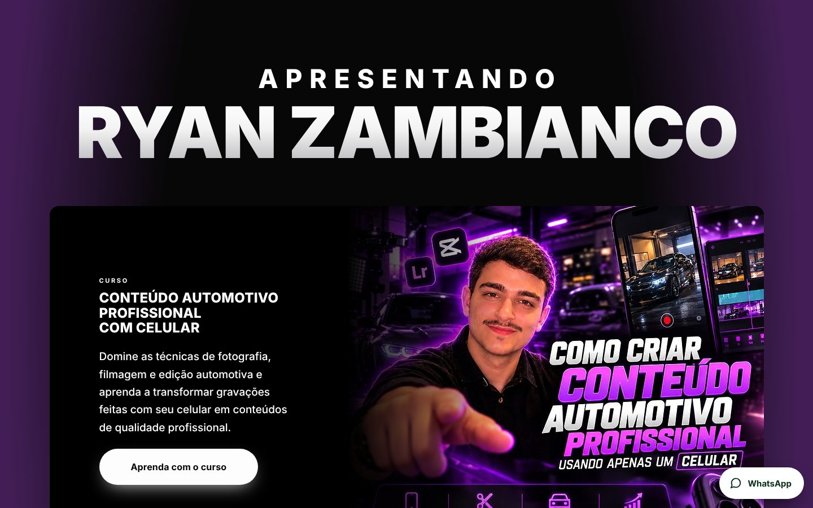
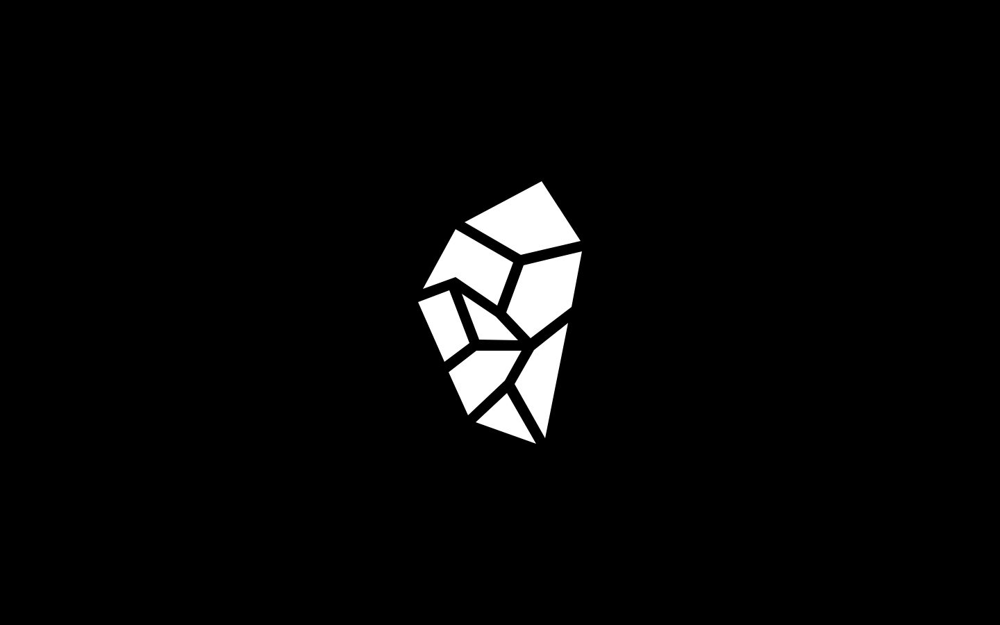
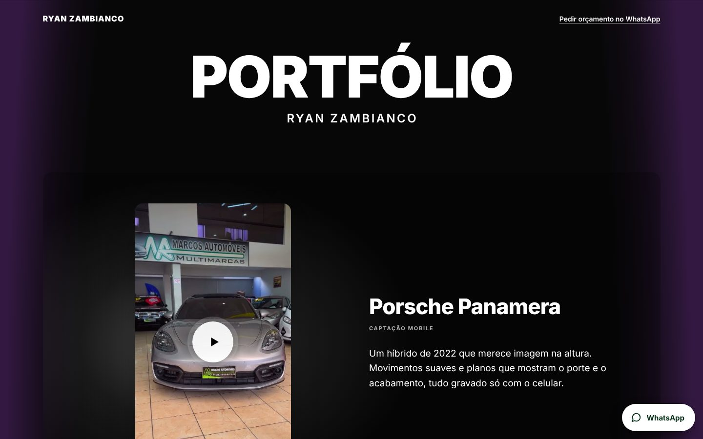
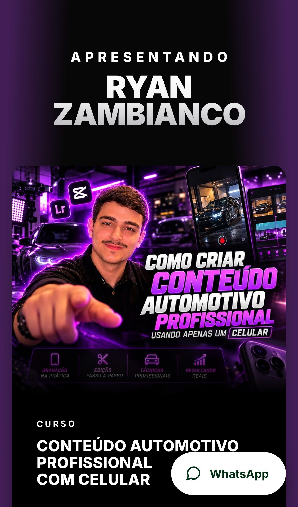
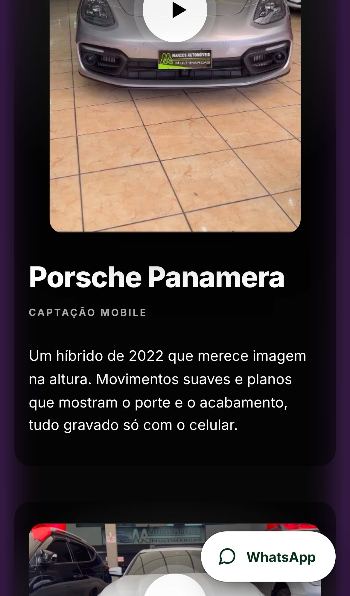
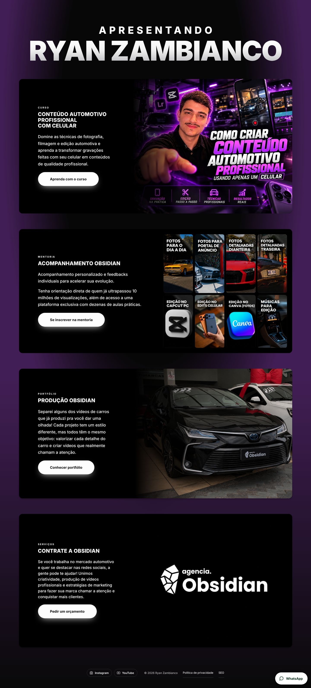

# Ryan Zambianco — site oficial

Site desenvolvido para **Ryan Zambianco**, criador de conteúdo e produtor audiovisual do universo automotivo. Ele reúne o curso, a mentoria, o portfólio de vídeos e a contratação de serviços da agência Obsidian em uma experiência escura, cinematográfica e rápida.

**🔗 No ar:** [agenciaobsidian.com.br](https://agenciaobsidian.com.br)



## O projeto

O layout foi desenhado no Figma e convertido à mão para HTML, CSS e JavaScript puros, sem frameworks e sem etapa de build. Do design ao ar, o trabalho incluiu:

- **Intro animada:** a logo da Obsidian, vetorizada em SVG, aparece da tela preta. A câmera "entra" em uma das faces do cristal e revela a página.
- **Animações de scroll:** os blocos entram pela esquerda, pela direita ou por baixo conforme a rolagem e saem ao voltar. Usam `IntersectionObserver` e só `transform` e `opacity`, para ficar leve em qualquer celular.
- **Mentoria em mosaico:** os 8 módulos aparecem em sequência e reagem ao passar o mouse.
- **Portfólio de vídeos:** cinco projetos com capa e botão de play. O vídeo só carrega ao clicar, já com som, e pausa os outros.
- **Política de privacidade (LGPD) e página de SEO** em janelas próprias, com textos adaptados ao negócio.
- **Integrações:** checkout do curso na Kiwify, inscrição da mentoria no forms.app e orçamento direto pelo WhatsApp.
- **Responsivo** do celular ao monitor grande, com ícone próprio para aba e tela inicial.
- **Publicação:** hospedagem na HostGator, com domínio, DNS e SSL configurados.

| Abertura | Portfólio |
|---|---|
|  |  |

| Celular — início | Celular — portfólio |
|---|---|
|  |  |

<details>
<summary>Página inicial completa</summary>


</details>

## Tecnologias

HTML5 · CSS3 (custom properties, keyframes, máscaras SVG) · JavaScript puro (IntersectionObserver, `<dialog>`) · Figma

## Estrutura

```
index.html       página inicial (intro, curso, mentoria, portfólio, serviços)
portfolio.html   portfólio de vídeos
politica.js      janelas de Política de privacidade e SEO
img/             imagens e ícones
video/           vídeos do portfólio
```

Para rodar localmente, basta abrir o `index.html` ou servir a pasta com qualquer servidor estático (ex.: `python3 -m http.server`).

---

Desenvolvido por **[VTdev07](https://github.com/VTdev07)**. Conteúdo, marca, fotos e vídeos © Ryan Zambianco / Obsidian, usados com autorização para fins de portfólio.
